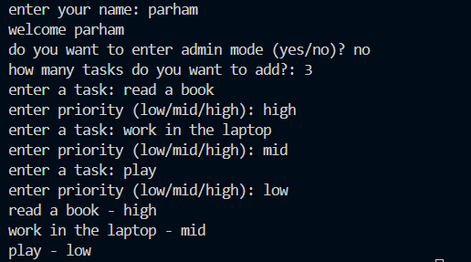

# Personal Task Manager


A simple task manager built with python

## Features
- add multiple tasks
- save tasks
- load saved tasks
- admin mode

## Task priority
each task can have one of these priority levels:
low 
medium
high

## Requirments
- python
- python-dotenv

## Project structur
```txt
│   .env
│   .gitignore
│   animation.gif
│   main.py
│   pic.png
│   README.md
│   requirments.txt
│   tasks.py
```
## Installation

```bash
python -m pip install -r requirments.txt
```

## Envoirment setup

create a `.env` file in the project folder

Use `.env.example` as a template

add your admin password 

```env
admin_pass=YOUR_PASSWORD_HERE
```
replace `YOUR_PASSWORD_HERE` with your own admin password

## run the program
run the main file
```bash
python main.py
```
## Screanshot


## demos 
